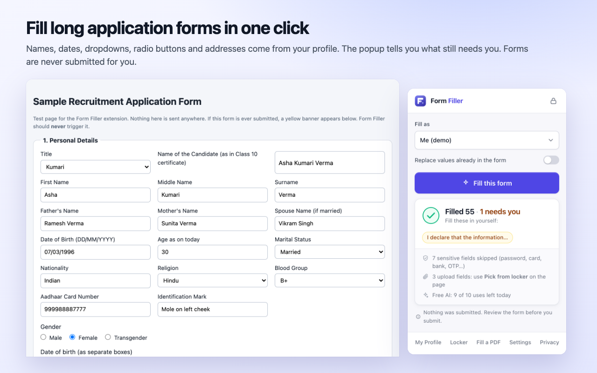
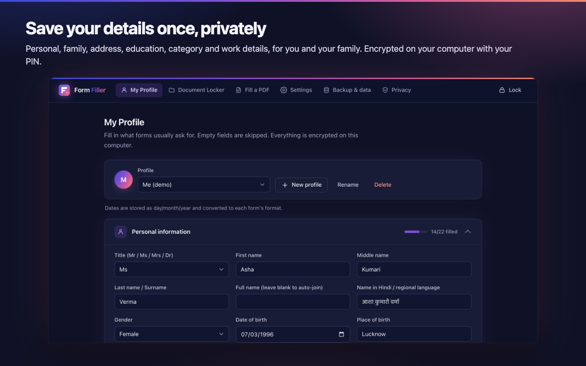
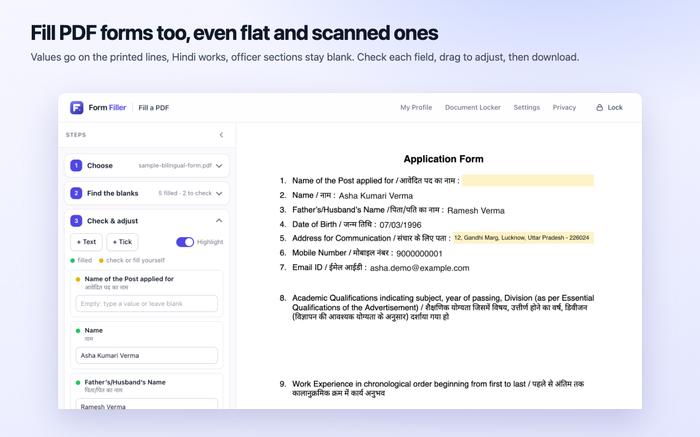
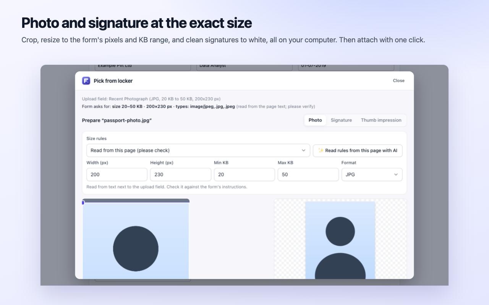
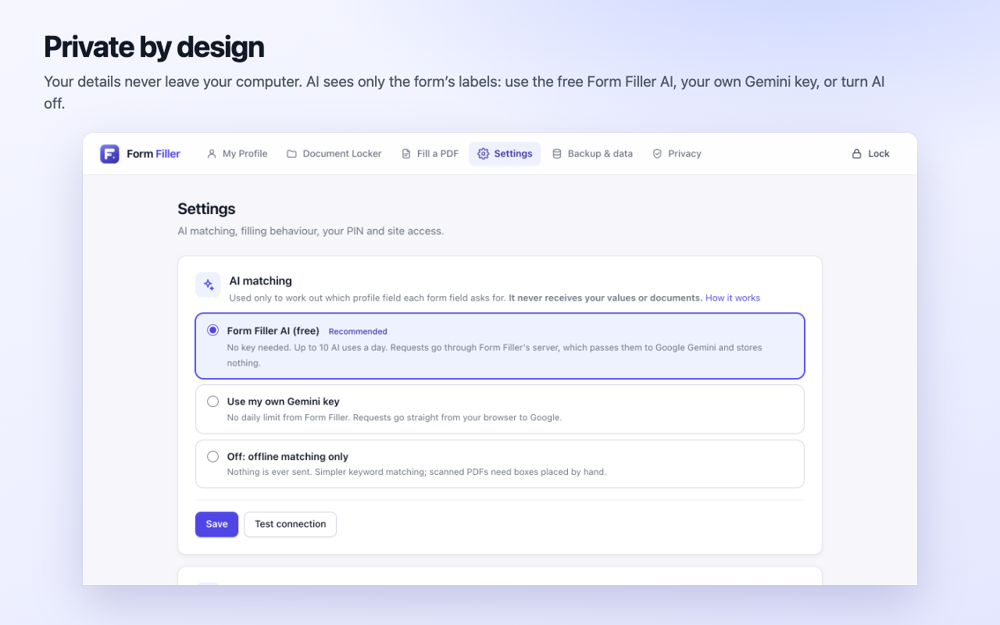

# Form Filler

**Fill job, exam and admission application forms, and their PDFs, in one click. Your details stay encrypted on your computer.**

Form Filler is a Chrome extension for people who fill the same details into form after form: name, father's name, date of
birth, addresses, education, category, documents. Save them once, open any application form, click **Fill this form**,
check what the popup says still needs you, and submit yourself.



## Features

**Web forms**
- Fills text boxes, dropdowns, radio buttons and checkboxes, including dates in any format (DD/MM/YYYY, separate
  day/month/year boxes, date pickers) and dropdowns that load after another one (State → District)
- Understands common labels and their variations: “Name of the Candidate”, “Father's/Husband's Name”, “S/o”,
  “Address for Correspondence”, Hindi labels (नाम, पिता का नाम, पता…)
- Just fills the values: the page itself isn't marked up. The popup sums it up, e.g. *“Filled 12 fields · 2 need your
  input: Mobile, Course”* (optional setting: highlight fields on the page). **Never submits a form**, and never touches
  password, card, CVV, bank, OTP or captcha fields

**PDF forms** (*Fill a PDF*)
- Fillable PDFs are filled directly and stay editable
- Flat and scanned PDFs: finds the blank lines, boxes and tick boxes and writes your values on them, including
  forms with underscores, bilingual (English / Hindi) labels and letter-by-letter boxes
- Officer sections (“Certifying Officer”, “For office use only”) are left blank
- A tidy side panel lists every field: edit any value, drag boxes, then download
- Hindi text is drawn correctly (bundled Noto Sans Devanagari, proper shaping)

**Photos, signatures and documents**
- An encrypted **Document Locker** for your photo, signature, marksheets and certificates
- **📎 Pick from locker** appears next to every upload field
- Crop and resize photos and signatures to the exact pixels and KB range the form asks for (read from the page, or
  presets for IBPS, SSC, UPSC, RRB, NEET), and clean signatures to a white background, all on your computer

**Everything else**
- Several profiles (you, your family), encrypted backup and restore, “Delete all data”
- Works offline; AI matching is optional (see below)

| | |
|---|---|
|  |  |
|  |  |

## Privacy approach

Form Filler is built so that **your details never leave your computer**.

- **Stored locally, encrypted.** Profiles, documents and settings live only in your Chrome profile, encrypted with
  AES-256-GCM using a key derived from your PIN (PBKDF2-SHA-256, 600,000 rounds). The key is kept only in memory and is
  erased on lock, after 5 minutes without use, or when Chrome closes.
- **Values are filled locally.** When AI is used, it only answers *which field is which*. It receives the form's own
  text (labels, placeholders, option texts), generic field names like `personal.dob`, and, only after you agree, an
  image of a **blank** PDF form. Your name, date of birth, address and other values are never sent.
- **You choose the AI** (Settings → AI matching):
  - **Form Filler AI (free)**: no key needed, 10 uses a day; requests go through a small server
    ([`server/`](server)) that passes them to Google Gemini and **stores nothing** (no content logs)
  - **Your own Gemini key**: requests go straight from your browser to Google
  - **Off**: offline keyword matching only; nothing is ever sent
- **No account, analytics, tracking or ads.** No remote code. Site access is requested only when you click
  *Fill this form* on a site.

Full details: **[Privacy policy](privacy.html)**.

## Install

### From the Chrome Web Store
*Coming soon.*

### Load unpacked (developer mode)
1. Download this repository: **Code → Download ZIP** (then unzip), or `git clone https://github.com/jayassingh94/form-filler.git`
2. Open `chrome://extensions` in Chrome and turn on **Developer mode** (top right)
3. Click **Load unpacked** and choose the `form-filler` folder (the one with `manifest.json`)
4. Pin Form Filler from the puzzle-piece menu
5. A short setup opens: create a PIN (at least 6 characters; it can't be recovered if forgotten), add your basic
   details (or choose *“Use demo data”* to try it with fake data), and see how to fill your first form

The free AI only works in builds that point at a deployed server (see below). Until then, choose **Use my own Gemini
key** (free key at [aistudio.google.com/apikey](https://aistudio.google.com/apikey)) or use offline matching.

### Try it on the sample forms
```
cd test && python3 -m http.server 8765
```
Open <http://localhost:8765/sample-form.html>, click the Form Filler icon → **Fill this form**.
`sample-dynamic-form.html` tests a form that appears late, inside shadow DOM, with a dependent City dropdown and an iframe.
For PDFs, open **Fill a PDF** from the popup and try `test/sample-flat-form.pdf`, `test/sample-bilingual-form.pdf`,
`test/sample-identity-certificate.pdf` or `test/sample-acroform.pdf`.

## Run the AI server

The server is plain Node (20+), with no dependencies.

**Locally**
```
cp server/.env.example server/.env        # then put your key in server/.env
export $(grep -v '^#' server/.env | xargs) && node server/server.mjs
# → http://localhost:8787/healthz , /privacy , POST /v1/ai
```
To use a local server from the extension: `node scripts/set-backend.mjs http://localhost:8787` and reload the extension.

**On Render (free plan)**
1. Render → **New → Blueprint** → this repository (it reads [`render.yaml`](render.yaml))
2. Set `GEMINI_API_KEY` in the service's *Environment* tab (never commit it)
3. Point the extension at it: `node scripts/set-backend.mjs https://<your-service>.onrender.com`

| Variable | Default | |
|---|---|---|
| `GEMINI_API_KEY` | required | Gemini key used by the server |
| `GEMINI_MODEL` / `GEMINI_FALLBACK_MODEL` | `gemini-3.5-flash-lite` / `gemini-3.6-flash` | model, and fallback when Gemini answers 503 |
| `DAILY_LIMIT_PER_INSTALL` · `DAILY_LIMIT_PER_IP` · `GLOBAL_DAILY_CAP` | `10` · `30` · `1000` | daily limits (in memory only) |
| `ALLOWED_ORIGINS` | empty | e.g. `chrome-extension://<extension id>` to accept only your extension |

The server accepts only three fixed request types (field labels, a blank page image, upload-rule text), builds the
prompt itself, masks e-mails and phone numbers as a safety net, and logs only time, request type, status and duration.

Publishing to the Chrome Web Store, step by step: **[store/PUBLISHING.md](store/PUBLISHING.md)**.

## Development

```
node --test tests/               # unit and server tests
node scripts/package.mjs         # build dist/form-filler-<version>.zip for the Web Store
```

| Path | What's there |
|---|---|
| `manifest.json`, `background.js` | Manifest V3 extension, fill orchestration |
| `content/` | in-page scanning, filling, optional highlights, locker buttons (`fillcore.js` holds the shared matching rules) |
| `lib/` | encrypted vault, profile schema, AI modes (`ai.js`, `gemini-core.js`), PDF text/geometry, image tools |
| `popup/`, `options/`, `pdf/`, `picker/` | popup, settings & profile pages, Fill a PDF, Pick from locker |
| `server/` | the free AI server (`server.mjs`, `limits.mjs`) |
| `store/` | Web Store icons, screenshots, promo tiles, listing text, publishing guide |
| `test/`, `tests/` | sample forms and PDFs, automated tests |
| `vendor/` | bundled third-party code and fonts (see below) |

## Third-party components

Bundled in `vendor/` under their own licenses: [pdf.js](https://github.com/mozilla/pdf.js) (Apache-2.0),
[pdf-lib](https://github.com/Hopding/pdf-lib) (MIT), [@pdf-lib/fontkit](https://github.com/Hopding/fontkit) (MIT),
[regenerator-runtime](https://github.com/facebook/regenerator) (MIT) and
[Noto Sans Devanagari](https://github.com/notofonts/devanagari) (SIL Open Font License 1.1).
`test/sample-identity-certificate.pdf` is a blank public application form used only as a test case.

## License

[MIT](LICENSE) © 2026 Jaya Singh

---

**Made by Jaya Singh** · [LinkedIn](https://www.linkedin.com/in/jaya-singh-781a98149)
